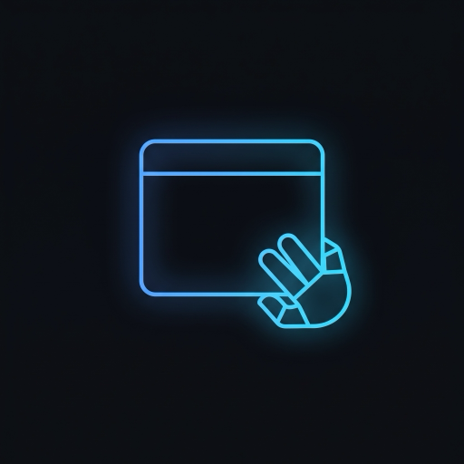
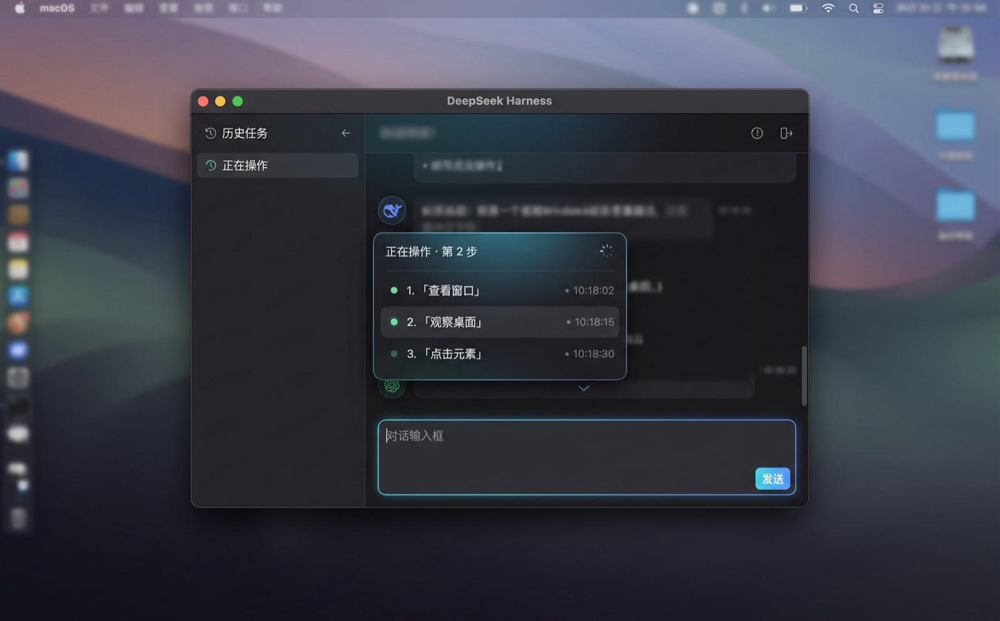

<p align="center">
  
</p>

# dsh-operator

> 给每个 DSH 会话一双手。



[](LICENSE)
[](https://github.com/deepseek-ai)
[](https://nodejs.org)
[](test/)

**dsh-operator** 是一个装一次、所有会话可用的 Computer Use 插件：安装进 DSH 的 desktop profile 后，无论你开「标准 / PTC / 极简 / 创造」哪种模式，会话里都会直接出现一套桌面 GUI 工具，支持看屏幕、点鼠标、敲键盘、开应用，也带一个后台 `code_agent`。不用建特殊会话，也不用切模式。

它不依赖任何外部账号、远程服务或运行时二进制：核心能力是纯 JavaScript + macOS 自带命令 + 一个编译好的小型 AX 助手。接入 cua-driver 只是可选增强，用来做「AI 在后台操作、你同时用电脑」的人机并行。

## 为什么值得装

- **装一次，全局可用**：挂在 host 层工具栈里，所有当前和将来的会话自动继承，不需要每个会话单独配。
- **观察自带省 token 机制**：Retina 截图先按长边 1280 + JPEG q80 编码再交给模型（约原图 1/4 的图片 token）；原生 App 额外附 AX 文本快照（通常约 1KB），比只给截图少猜很多。
- **动作有校验**：每次动作后自动重采并比较，给出 `actionEffect`（confirmed / unverifiable / suspected_noop）；失败会附上可读提示，而不是让模型瞎猜。
- **后台人机并行（可选）**：接入 cua-driver 后，`cua_launch` 后台启动 App、`cua_observe` 读窗口、`cua_act` 在后台点击/输入，**不移动你的真实光标、不抢占焦点**；你也可以选择不装，全部基础工具照常可用。
- **安全边界清楚**：危险快捷键/「删除」类按压默认拦截（`guard`）；审计日志只记元数据、不存屏幕内容；失败样本自动脱敏；剪贴板用完还原。
- **代码可自持**：MIT，全部能力代码在本仓库维护、无外部补丁链，490 项测试 + CI 全绿；欢迎自己改、自己发布。

## 3 分钟上手

```bash
# 1. 装进 desktop profile
dsh plugin --profile desktop add dsh-operator

# 2. 完全退出 DSH（⌘Q），再重新打开
```

首次使用 GUI 工具时 macOS 会弹「屏幕录制 / 辅助功能」授权，允许给 DeepSeek Harness（或你的 DSH 宿主 App）即可。打开任意会话，问它「截一张图看看我的屏幕」，能返回截图就说明通了。

**升级**：`dsh plugin --profile desktop update dsh-operator`（或再 `add` 一次），然后重启 App。
**卸载**：`dsh plugin --profile desktop remove dsh-operator`。

> 改动前想留后路：备份 `~/.dsh/profiles/desktop/` 下的 `package.json`、`pnpm-lock.yaml`、`cordis.patch.yml` 三件套即可回滚。
> 想跑仓库最新代码而不是发布版：`git clone https://github.com/yffo/dsh-operator && dsh plugin --profile desktop add file:$PWD`。

## 怎么跟它说话

装好之后不用记命令，**用平时的说法讲清「目标 + 验收标准」**就行：

| 你会说 | 它就去做 |
| --- | --- |
| 「打开系统设置，确认在「外观」页，截个图给我」 | 先看再开、最后给截图 |
| 「先看看现在前台是什么，别乱点」 | 只读观察 |
| 「这个流程存成技能，叫 archive-screenshots」 | 存成可回放的技能 |
| 「这是跨应用任务，先做计划再动手，每步校验」 | 生成计划并逐步执行 |
| 「写个交接」/ 新窗口只说 **「接手」** | 交接与无缝续做 |

完整口语用法、出错时怎么问、它不会做什么，见 **对话式使用指南**。

> 只想让它看、不让它动：跟它说「只读模式」，或把 profile 的 `guiTools` 设为 `false`。

## 工具一览

会话里实际能用的工具（旧版名字默认保留，可用配置 `legacyToolNames` 关闭）：

| 类别 | 工具 |
| --- | --- |
| 观察 | `screenshot`（截图+前台信息）、`wait` / `long_wait`、`cu_observe`（按窗口读 AX/截图）、`screenshot_window`、`list_windows`、`zoom_region`（局部原生分辨率放大）、`ocr`（Vision 文本兜底：AX 拿不到时读截图，返回带坐标的文本行） |
| 鼠标 / 键盘 | `click`、`drag`、`scroll`、`input_text`、`hotkey`、`long_press`、`cu_act`（后台动作） |
| AX 动作 | `ax_press`、`ax_set_value`、`ax_scroll`、`ax_menu`、`ax_batch`（2–12 个动作一批，可混跑桌面与浏览器动作） |
| 窗口 / 应用 | `list_apps`、`open_app`（前台激活）、`cua_launch`（后台启动，不置顶）、`open_in_browser`、`open_in_finder`、`window_move`（含 left/right-half 等预设） |
| 浏览器 DOM | `browser_dom_snapshot`、`browser_dom_click`、`browser_dom_fill`、`browser_dom_probe`（Chrome/Safari，AppleScript 优先，CDP 回退） |
| 浏览器自动化 | `browser_state`、`browser_prepare`（可按 app 名找窗口）、`browser_open`、`browser_click`（ref 或文案）、`browser_type`、`browser_pointer`、`browser_select`、`browser_key`、`browser_dialog`、`browser_download`、`browser_set_input_files`（经 cua-driver：真实 profile、语义 ref、受信任输入） |
| 浏览器 CDP | `browser_wait`、`browser_read`、`browser_console`、`browser_network`（需 `browserCdpPort` + Chrome `--remote-debugging-port`：等网络空闲/等元素、读页面可见文本、看控制台错误、看失败请求） |
| 剪贴板 | `clipboard_read`、`clipboard_write`（文本/图片/文件；只读文本默认 4000 字符，硬顶 20000） |
| 任务 / 技能 | `task_profile`、`plan_create/list/update/run/delete`、`skill_save/list/show/run/delete` |
| 后台会话 | `code_agent`（另起标准会话执行代码/长任务） |
| 查询 / 诊断 | `verify_state`（窗口标题/AX/前台等谓词轮询）、`operator_status`、`failure_list`（失败样本摘要） |

## 可选：cua-driver 人机并行

基础工具用的是「真实键盘鼠标」语义；如果你希望 **AI 操作的同时自己继续用电脑**，接入 cua-driver：

```bash
# 1. 安装 cua-driver（见官方文档），确认：
cua-driver --version

# 2. 首次授权（Accessibility + Screen Recording 一次）
cua-driver permissions grant

# 3. 试试后台流程
#    cua_windows -> cua_observe -> cua_act / cua_launch
```

- `cua_windows`：列出窗口和 `window_id`（不需要前台）。
- `cua_observe window_id=…`：读该窗口的 AX 树（`[N]` 行 + `element_token`），可选截图附件。
- `cua_act window_id=… action=click role=… name=…`：后台点击/输入，默认 `delivery_mode=background`。
- `cua_launch bundle_id=com.apple.Safari`：后台启动 App 或打开文件/URL，不抢焦点。

环境变量：`DSH_OPERATOR_CUA=0` 关闭 cua 工具；`DSH_OPERATOR_CUA_BIN` 指定 `cua-driver` 路径；`DSH_OPERATOR_CUA_SOCKET` 指定 daemon socket。完整参数与已知限制见 docs/CUA-DRIVER.md。

## 浏览器自动化（真实 profile）

`browser_*` 走 cua-driver 的浏览器通道，直接操作**你正在用的 Chrome/Edge/Brave**（真实登录态、真实扩展、无自动化启动参数）：

```bash
# 1. 找到浏览器窗口
cua_windows app_contains="Chrome"
# 2. 绑定并拿语义快照（首次会要求授权；macOS Chrome 会弹一次它自己的调试确认）
browser_prepare pid=… window_id=… delivery_mode="foreground"
browser_state pid=… window_id=…        # 返回 target_id / tab_id / tabs / refs
# 3. 操作（ref 形如 p1:12，导航后失效）
browser_open url="https://example.com/"
browser_state target_id=… tab_id=…
browser_click ref="p1:2"
browser_type  ref="p1:5" text="hello" replace=true
browser_pointer action="scroll" delta_y=-600
```

- 输入默认走 `Input.dispatchMouseEvent`（受信任事件，不是 `element.click()`）；需要合成点击时才传 `input_route:"dom_event"`。
- 绑定用户浏览器需要显式授权；`background_unavailable` 时用 `delivery_mode:"foreground"`。
- 不读 Cookie/密码、不伪造指纹、不绕验证码；遇到挑战会停下并在提示里让你接管。
- `DSH_OPERATOR_BROWSER=0` 关闭这组工具；cua-driver < 0.38 时自动跳过。细节见 docs/BROWSER-AUTOMATION.md。

### 自带实例：独立窗口、用完即关

需要干净的登录环境（换个账号）或后台跑任务、不想动自己的浏览器时，让插件自己开一个实例——
**独立 profile（独立 cookie）+ 独立调试端口**，不碰你正在用的浏览器：

```bash
browser_launch headless=false            # 返回 pid / port / profileDir
browser_state  port=…                    # 后续 browser_* 都带这个 port
browser_close  port=…                    # 用完即关，临时 profile 自动删除
```

- 独立实例是按需的：不启动、不常驻，关掉就干净了，不会多一个窗口一直挂着。
- 传 `user_data_dir` 可以保留登录态，下次接着用；不传则用临时目录、关闭时删除。
- 与上面「真实 profile」的区别：那条复用的是你已有的登录态，这条是隔离出来的干净环境。

### 页面开发与调试

除了点击输入，还有四个页面开发用的工具（都走 CDP，读优先）：

```bash
browser_eval expression="document.querySelectorAll('.item').length"   # 跑一个表达式，返回 JSON 值
browser_selector selector="#submit"                                    # 元素存在性 / 盒子 / 计算样式 / 属性
browser_screenshot selector=".chart"                                   # 截图存盘，返回路径（read_image 查看）
browser_launch headless=false window_size={width:1280,height:800}      # 启动时定视口
```

- `browser_eval` 只接受**单个表达式**，不是脚本块；表达式碰到 cookie / 存储 / 网络时会自动带一句敏感提示。
- 视口尺寸在**启动时**用 `window_size` 定（实测运行时 Emulation 覆盖在 Chrome 156 上不改变 layout viewport）；
  宽度精确，高度按窗口算（含浏览器 UI，实际视口会小约 87px）。
- 页面调试常用组合：`browser_console`（报错）+ `browser_network`（失败请求）+ `browser_selector`（元素为什么看不见）。

## 为什么省 token

Computer Use 的成本主要不在截图数量，而在每张图多大：

- 2x Retina 全屏截图直接进模型，单张图片就是几千 token；本插件先缩到长边 1280 再按 q80 编码，量级约为原图的 1/4。
- 观察只带「当前这一张」截图，不为每一步上传历史图。
- 原生 App 额外给 AX 文本（`<ax_snapshot>`，通常 1KB 左右），模型能按「名字/角色」定位而不是从像素里猜坐标；Web/Electron 的 AX 树很浅时会自动退回纯视觉，不为没用信息付 token。
- 工具策略提示词做过瘦身（8.4KB → 3.9KB），全局会话每轮都在省。
- `suspected_noop`、`clipped`、`imageError` 等降级提示都能减少「模型反复重试同一动作」造成的浪费。

## 安全与边界

- **安装即授权**：插件能控制桌面和读取屏幕；装之前请确认这是你愿意用的工具。
- **guard**：危险快捷键（如强制退出）和「删除/移除/支付/发送」类静默按压会被拦截；确认要做时可显式 `confirm: true`。
- **审计**：`~/.dsh/dsh-operator/audit.jsonl` 记录动作事件（窗口 id、动作类型、结果计数等元数据），不记录屏幕内容、不记录输入文本。
- **失败样本**：仅保留工具名/错误类别/消息摘要与参数长度，不含文字内容；`npm run failures` 可导出摘要，`failure_list` 工具可直接看。
- **剪贴板**：输入长文本时临时使用「快照 → 写入 → 粘贴 → 还原」，不会把你的剪贴板内容发给模型。
- **网络**：插件本身不上传任何数据；截图会随会话请求发给模型服务商，这是 Computer Use 本身的代价。

## 已知限制

- **平台面（0.33.0）**：macOS 已验证；Windows/Linux「代码兼容、未验证」——Windows 基础 GUI 后端（GDI `BitBlt` + `SendInput`）能加载但没有真机验收，Linux 能加载但桌面后端未实现（调用报 `unsupported_platform`）；扩展工具（AX/浏览器/剪贴板）只在 macOS 注册。`operator_status` / `doctor` 会明确打印 `UNVERIFIED`，不冒充支持。
- 多屏混合 DPI 跨屏截图可能有裁切误差（`clipped`/`visibleBounds` 会提示）。
- 纯视觉定位仍然是兜底；无 AX 的 canvas/WebGL 界面只能点像素。
- `ax_menu` 需要前台进程有菜单栏；`open_app` 是前台激活（想要后台启动就用 `cua_launch`）。
- `window_move` 对 Finder 部分窗口会被系统拒绝尺寸（高度纵向被夹紧时以返回 frame 为准）；多窗口拖拽先把「目标窗口」置顶，否则落点会交给最上层窗口。
- cua 相关：需要另装 cua-driver 并授权；`element_token` 只在相邻 `cua_observe → cua_act` 之间有效（跨调用会过期，插件自动重试一次）；Electron/Chromium 后台输入可能回退前台一次。
- `guard` 仍是 v1：按标题/关键词判断，没有 hit-test；误拦时用 `confirm: true` 放行。

## 配置

`~/.dsh/profiles/desktop/cordis.patch.yml` 里给 `computer-use` 插件加配置（都有合理默认，通常不用改）：

| 键 | 默认 | 说明 |
| --- | --- | --- |
| `captureMaxEdge` | `1280` | 观察截图长边上限（0 = 不缩放） |
| `jpegQuality` | `80` | 重编码质量（100 = 不重编码） |
| `axObservation` | `true` | 原生 App 观察是否附 AX 文本 |
| `firstFrame` | `"auto"` | 首帧观察策略：auto / eager / off |
| `guard` | `true` | 危险动作拦截 |
| `auditLog` | `true` | 无内容审计日志 |
| `legacyToolNames` | `true` | 保留旧工具名别名 |
| `failureSamples` | `true` | 写脱敏失败样本 |

cua-driver 相关：`DSH_OPERATOR_CUA`、`DSH_OPERATOR_CUA_BIN`、`DSH_OPERATOR_CUA_SOCKET`。

## 排障

```bash
npm run doctor      # 安装/数据目录/权限/日志等 9 项体检
npm run preflight   # 隔离环境里做一次 DSH 引导，抓插件加载错误
npm run failures    # 失败样本摘要（按错误类别分组）
npm test            # 490 项测试
```

会话里也可以直接问 `operator_status`（版本/工具面/审计行数），或列出失败样本（`failure_list`）。

## 文档

使用指南就是本 README；问题、建议、用法讨论请开 [issue](https://github.com/yffo/dsh-operator/issues)。

## 更新记录

每个版本的变更见 [Releases](https://github.com/yffo/dsh-operator/releases)——tag 即版本，release notes 是当时写下的说明。
README 里不再维护版本流水账。

## 路线图

**进行中**

- **视觉解析（低 AX 场景）**：先接 cua-driver 的 `parse_visual_regions` → 等上游 `cua-perception` 扩展的签名 catalog 发布
  后，做持久 MCP 连接（现在的 `cua-driver call` 是一次性进程，解析不了跨进程的 `capture_id`）并做真机验证。
  当前可用兜底：`ocr` 读文字 + 坐标点击（零依赖），见上文「AX 树为空时怎么办」。

**排队中**

- 真实画布/游戏应用的真机验证（Blender / Sketch 这类纯自绘界面）。
- 多屏混合 DPI 的跨屏截图校准。
- Windows 真机验证。
- 更完整的官方 seam provider 运行态（受 desktop 组合层顺序限制，暂缓）。
- 用 5 类真实任务做公开可复现的基线数据（成功率 / 步数 / token / 耗时）。

## 许可

MIT。第三方组件的版权与许可声明集中在 [NOTICE](NOTICE)；其余为本项目自有代码。
